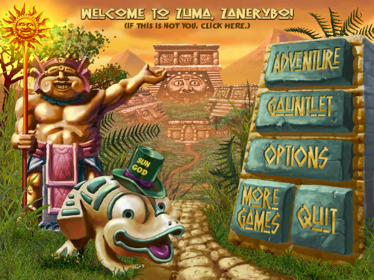

# Zuma Neural Agent

Небольшая нейросеть, которая играет в настоящую **Zuma Deluxe**: видит экран, оценивает цели и управляет мышью. Итоговая MLP содержит всего **2 817 параметров**.

В локальных прогонах завершена кампания **76/76 уровней**, а в Gauntlet получен ранг Sun God на **22 картах и Random**. Финальный результат — настоящая зелёная шляпа в главном меню.



## Как это работает

```text
Видимый экран → распознавание шаров → признаки целей → MLP → прицел и выстрел
                       ↑                              ↓
          геометрия установленной игры       контроль фокуса и переходов
```

Компьютерное зрение определяет карту, цвета и позиции шаров. Для каждого возможного выстрела вычисляются десять признаков: совпадение цвета, размер группы, положение в цепочке, расстояние, препятствия и другие. Сеть `10 → 64 → 32 → 1` оценивает кандидатов; контроллер учитывает движение цепочки, траекторию, смену шара и готовность пушки.

Модель обучена **дистилляцией эвристического учителя** на 120 000 векторах признаков: синтетических и извлечённых из реальной игры. Во время автономного прогона цели выбирает сеть. Это обучение с учителем; PPO и обучение по награде не реализованы. Работа со зрением, геометрией и меню выполняется обычным кодом.

В проекте также сохранён первоначальный CNN-прототип для обучения на человеческих демонстрациях. Для кампании и Gauntlet используется отдельный MLP, чьи обученные веса включены в репозиторий.

## Требования

- **Windows** и Python **3.11+**. Захват окна и управление используют Win32 API.
- Отдельно установленная Zuma Deluxe. Проверялась Steam-версия; файлы игры в репозиторий не входят.
- CPU достаточно для готового MLP. CUDA необязательна.
- Для дополнительной записи экрана нужен FFmpeg в `PATH`.

## Установка

Команды ниже выполняются в PowerShell из корня репозитория:

```powershell
git clone https://github.com/zanerybop/zuma-neural-agent.git
cd zuma-neural-agent
python -m venv .venv
.venv\Scripts\python.exe -m pip install -e ".[dev]"

# Укажите свою папку с Zuma.exe, levels/ и images/.
$env:ZUMA_GAME_DIR = 'C:\Program Files (x86)\Steam\steamapps\common\Zuma Deluxe'
.venv\Scripts\python.exe -m zuma_agent.cli doctor
```

`requirements-win.lock` фиксирует версии проверенной среды. Для повторения её зависимостей используйте `pip install -r requirements-win.lock` перед установкой проекта.

## Запустить обученного агента

Откройте игру, начните уровень **1-1** и переведите её в оконный режим. Окно должно быть видимым и иметь фокус. В командах ниже первые пять секунд отведены на переключение из PowerShell в Zuma: сам агент фокус не переключает. Вставьте блок целиком и вернитесь в окно игры.

```powershell
Start-Sleep -Seconds 5
.venv\Scripts\python.exe -m zuma_agent.campaign `
  --stage 1 --level 1 --adaptive-lead --precise-ammo `
  --seconds 600 --output runs/campaign-001
```

По умолчанию загружается `models/target-ranker.pt`. Другой checkpoint задаётся через `--checkpoint`, путь к игре — через `--game` или переменную `ZUMA_GAME_DIR`. Для другого текущего уровня измените `--stage` и `--level`; они должны совпадать с экраном. Если уровень стоит на паузе, добавьте `--resume`.

**Управление занимает мышь.** F9 или Esc останавливает попытку; потеря фокуса также прекращает управление. Можно создать файл `STOP` в каталоге попытки. Одновременно запускайте только один контроллер и используйте новую папку `--output` для каждого прогона.

Gauntlet запускается отдельно, из экрана выбора карт:

```powershell
Start-Sleep -Seconds 5
.venv\Scripts\python.exe -m zuma_agent.gauntlet --output runs/gauntlet-session-001
```

## Обучение

Первоначальный CNN учится по записям действий игрока:

```powershell
.venv\Scripts\python.exe -m zuma_agent.cli record --seconds 600
.venv\Scripts\python.exe -m zuma_agent.cli train --epochs 25
.venv\Scripts\python.exe -m zuma_agent.cli play --seconds 60
.venv\Scripts\python.exe -m zuma_agent.cli play --control --seconds 60
```

В записи F8 включает и приостанавливает сбор, F9/Esc завершает его. В `play` F8 включает предсказания/управление; без `--control` клики не отправляются. Этот CNN нужно обучить самостоятельно: его веса и человеческие демонстрации не включены.

Для нового MLP доступен bootstrap на признаках с метками учителя:

```powershell
.venv\Scripts\python.exe -c "from zuma_agent.ranker import bootstrap; bootstrap(output='runs/ranker/best.pt')"
```

Без локального корпуса реальных кандидатов это создаёт модель на синтетических признаках, поэтому она не обязана повторять опубликованные веса или их игровые результаты. Метрика `validation_rmse` измеряет приближение учителя, а не долю побед.

## Результаты и ограничения

| Режим | Зафиксированный результат | Условия |
|---|---|---|
| Adventure | 76/76 уровней, включая 13-1 | Серия попыток с доработками агента, разными версиями MLP и обычными рестартами |
| Gauntlet | Sun God на 23/23 пунктах | Один и тот же итоговый checkpoint, включая Random |
| Главное меню | Видимая шляпа Sun God | Подтверждена 8 ноября 2026 года |

[Компактный манифест](docs/results.json) содержит хеши исходных подтверждений и модели. Перед публикацией проверены наличие всех 76 экранов победы и совпадение checkpoint во всех 23 подтверждениях Gauntlet. Полные журналы, отдельные кадры каждого уровня и исходные записи сохранены локально; здесь размещены итоговые кадры и сводка. [Финальный экран кампании](docs/assets/campaign-complete.png).

Прохождение включает поражения, повторы и исправления контроллера. Эти результаты не являются статистикой независимых запусков и не гарантируют успех на другом разрешении или из другого состояния игры. OCR и распознавание могут ошибаться. Агент не изменяет сохранения, сложность, файлы игры или память процесса.

## Проверка и структура

```powershell
.venv\Scripts\python.exe -m pytest -q
```

При подготовке публикации 8 ноября 2026 года прошли **48 тестов**. Опубликованный checkpoint загружен через `torch.load(weights_only=True)` и проверен на CPU; заново запускать игру для этих проверок не требовалось.

| Каталог | Содержимое |
|---|---|
| `zuma_agent/` | Зрение, модели, обучение, управление, навигация и запись |
| `models/` | Итоговые веса MLP и метаданные обучения |
| `tests/` | Геометрия, признаки, обучение, OCR и ограничения управления |
| `docs/` | Итоговые кадры и компактный отчёт о результатах |

Локальные данные, окружения Python, видео и результаты новых попыток исключены через `.gitignore`. Zuma Deluxe и её игровые материалы принадлежат соответствующим правообладателям; проект не связан с разработчиками игры.
